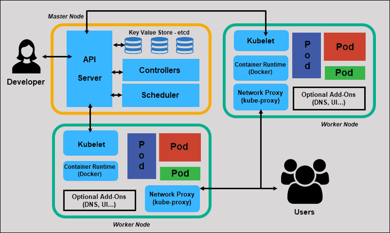
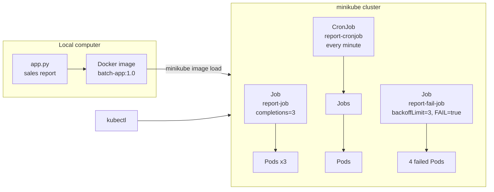
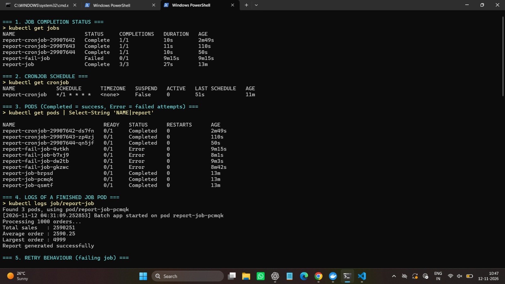
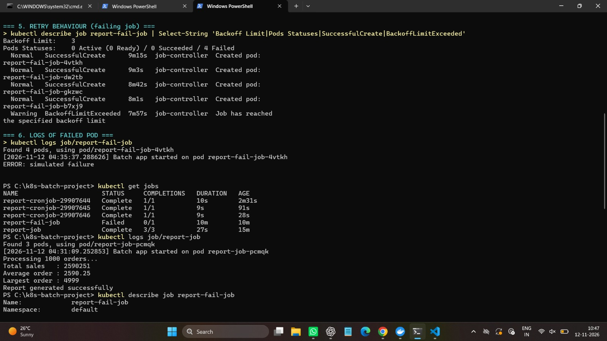
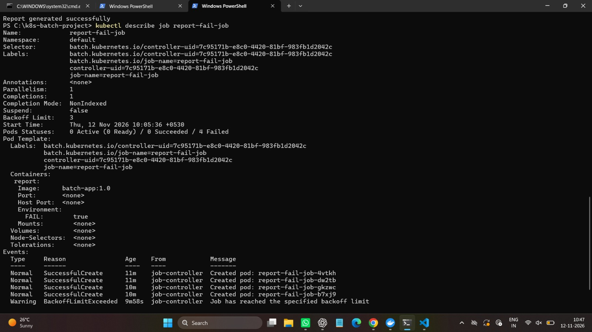
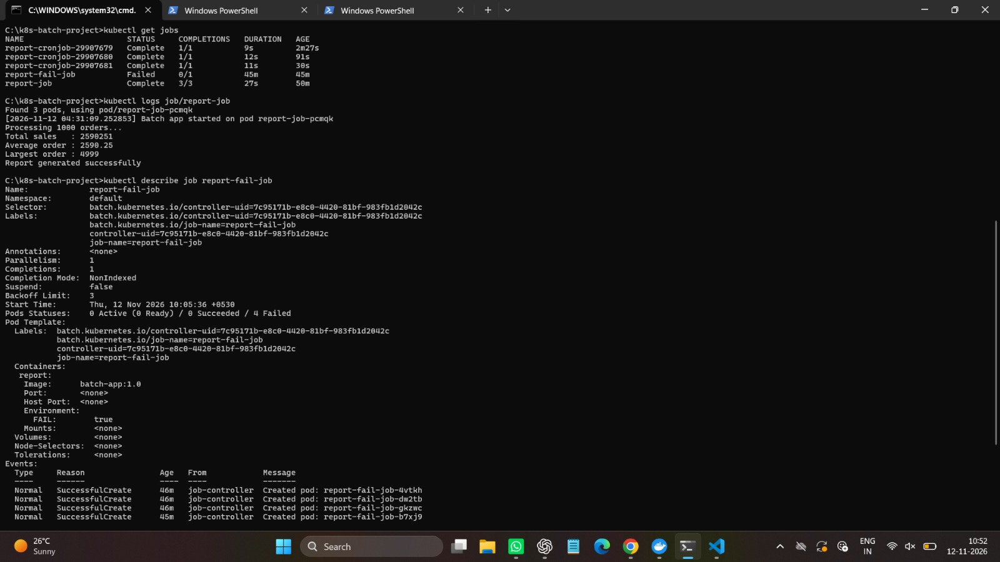

# Jobs and CronJobs for Batch Workloads on Kubernetes

**Cloud Computing Laboratory ·**

> Running a one-time batch task as a Kubernetes **Job** and a recurring task as a **CronJob**, and observing completion, retries and scheduling.

---

## Table of Contents

1. [Aim](#1-aim)
2. [Objectives](#2-objectives)
3. [Problem Statement](#3-problem-statement)
4. [Why This Problem Matters](#4-why-this-problem-matters)
5. [Software and Hardware Requirements](#5-software-and-hardware-requirements)
6. [Theory (Summary)](#6-theory-summary)
7. [System Design](#7-system-design)
8. [Repository Structure](#8-repository-structure)
9. [Procedure (Summary)](#9-procedure-summary)
10. [Results and Observations](#10-results-and-observations)
11. [Conclusion](#11-conclusion)
12. [Learning Outcomes](#12-learning-outcomes)
13. [Viva Questions](#13-viva-questions)
14. [References](#14-references)

**Detailed documents:**
[1. Kubernetes Fundamentals](docs/01-kubernetes-fundamentals.md) ·
[2. Jobs and CronJobs Theory](docs/02-jobs-and-cronjobs-theory.md) ·
[3. Procedure](docs/03-procedure.md) ·
[4. Observations and Results](docs/04-observations-and-results.md) ·
[5. Viva Questions](docs/05-viva-questions.md)

---

## 1. Aim

To run a one-time batch task as a Kubernetes **Job** and a recurring task as a **CronJob**, and to demonstrate how **completion, retries and scheduling** are handled by Kubernetes.

## 2. Objectives

After completing this experiment the student will be able to:

1. Set up a local Kubernetes cluster (minikube) and verify it with `kubectl`.
2. Package a Python batch application as a Docker image and make it available to the cluster.
3. Create a **Job** with a completion count and a retry limit, and verify its completion status.
4. Create a **CronJob** with a cron schedule and observe its run history.
5. Inspect the Pods created by Jobs using `kubectl logs` and `kubectl describe`.
6. Test a **failing Job** and observe the retry (exponential back-off) behaviour and the `BackoffLimitExceeded` condition.
7. Distinguish between long-running workloads (Deployments) and run-to-completion workloads (Jobs, CronJobs).

## 3. Problem Statement

Run a one-time batch task as a Kubernetes Job and a recurring task as a CronJob. Demonstrate how completion, retries and scheduling are handled.

**Approach:** create a Job with a completion count and retry limit, create a CronJob with a schedule, view the logs of the created Pods, and test a failing Job to see the retry behaviour.

**What is measured / demonstrated:**

* Job completion status
* Retry attempts
* CronJob run history
* Logs of finished Pods

## 4. Why This Problem Matters

Not every workload is a long-running service. Jobs and CronJobs manage tasks that must **run to completion** (reports, migrations, data processing) or **run on a schedule** (backups, clean-up). Kubernetes gives these tasks the same benefits as services: automatic retry, tracking of completion, per-run logs and no manual supervision.

## 5. Software and Hardware Requirements

| Item | Details |
|---|---|
| Operating system | Windows 10/11 (macOS and Linux also work) |
| Container engine | Docker Desktop |
| Kubernetes | minikube (Docker driver), Kubernetes v1.35.1 |
| CLI | `kubectl`, `minikube` |
| Language / base image | Python 3.12 (`python:3.12-slim`) |
| Editor | Visual Studio Code or any text editor |
| Hardware | 2+ CPU cores, 4 GB+ free RAM, 10 GB free disk |

## 6. Theory (Summary)

> Full explanation: [Kubernetes Fundamentals](docs/01-kubernetes-fundamentals.md) and [Jobs and CronJobs Theory](docs/02-jobs-and-cronjobs-theory.md).

**Kubernetes** is an open-source container orchestration platform that automatically runs, heals and scales containers across a cluster of machines. A cluster consists of a **control plane** (API Server, etcd, Scheduler, Controller Manager) that decides what should happen, and **worker nodes** (kubelet, kube-proxy, container runtime) that run the applications inside **Pods**.



| Workload type | Kubernetes object | Behaviour |
|---|---|---|
| Long-running service | Deployment | always running; restarted if it exits |
| One-time batch task | **Job** | runs until the required number of Pods succeed, retries on failure |
| Scheduled batch task | **CronJob** | creates a Job at every tick of a cron schedule |

**Key Job fields:** `completions` (successful runs required), `parallelism` (Pods at the same time), `backoffLimit` (retries before failure), `restartPolicy` (`Never` or `OnFailure`).

**Key CronJob fields:** `schedule` (cron syntax), `successfulJobsHistoryLimit`, `failedJobsHistoryLimit`, `jobTemplate`.

## 7. System Design



**Sample application ([`app/app.py`](app/app.py)).** A Python program simulating a daily sales report. It generates 1000 random orders and prints the total, average and largest order. If `FAIL=true` is set, it exits with status 1 to simulate a failed task.

## 8. Repository Structure

```
k8s-jobs-cronjobs-lab/
├── README.md                     ← this file (lab report front page)
├── LICENSE
├── app/
│   ├── app.py                    ← sample batch application
│   └── Dockerfile                ← container image definition
├── manifests/
│   ├── job-app.yaml              ← Experiment 1: Job (3 completions)
│   ├── cronjob-app.yaml          ← Experiment 2: CronJob (every minute)
│   └── job-app-fail.yaml         ← Experiment 3: failing Job (retries)
├── scripts/
│   ├── show-results.ps1          ← prints all evidence on one screen
│   └── cleanup.ps1               ← removes lab resources
├── setup/
│   └── kind-config.yaml          ← optional 3-node kind cluster
└── docs/
    ├── 01-kubernetes-fundamentals.md
    ├── 02-jobs-and-cronjobs-theory.md
    ├── 03-procedure.md
    ├── 04-observations-and-results.md
    ├── 05-viva-questions.md
    └── images/                   ← architecture diagram and screenshots
```

## 9. Procedure (Summary)

> Complete step-by-step instructions with expected output and troubleshooting: [docs/03-procedure.md](docs/03-procedure.md)

```powershell
# 1. Start the cluster
minikube start --driver=docker
kubectl get nodes

# 2. Build the image and load it into minikube
docker build -t batch-app:1.0 ./app
minikube image load batch-app:1.0

# 3. Experiment 1: Job
kubectl apply -f manifests/job-app.yaml
kubectl get jobs --watch
kubectl logs job/report-job

# 4. Experiment 2: CronJob (wait 3-4 minutes)
kubectl apply -f manifests/cronjob-app.yaml
kubectl get cronjob
kubectl get jobs

# 5. Experiment 3: failing Job
kubectl apply -f manifests/job-app-fail.yaml
kubectl get pods --watch
kubectl describe job report-fail-job

# 6. Show all evidence, then clean up
powershell -ExecutionPolicy Bypass -File .\scripts\show-results.ps1
powershell -ExecutionPolicy Bypass -File .\scripts\cleanup.ps1
```

## 10. Results and Observations

> Full results with all screenshots and timing analysis: [docs/04-observations-and-results.md](docs/04-observations-and-results.md)

| Item to demonstrate | Observed result |
|---|---|
| **Job completion status** | `report-job   Complete   3/3   27s` |
| **Retry attempts** | 4 Pods failed (1 initial + 3 retries) with delays of ≈12 s, 21 s and 41 s (exponential back-off) |
| **Retry limit** | Job marked `Failed`, event `BackoffLimitExceeded` |
| **CronJob run history** | one Job per minute (`report-cronjob-29907642`, `…643`, `…644`); only the last 3 successful runs retained |
| **Logs of finished Pods** | sales report on success; `ERROR: simulated failure` on failure |

### Screenshots

**Job, CronJob, Pods and logs**


**Retry behaviour and `BackoffLimitExceeded`**


**`kubectl describe job report-fail-job`**


**CronJob history later in the run (only the last 3 runs remain)**


## 11. Conclusion

The experiment showed that Kubernetes can manage run-to-completion and scheduled workloads as well as long-running services:

* A **Job** with `completions: 3` ran three Pods to successful completion and then stopped.
* A **failing Job** was retried with increasing delays and, after reaching `backoffLimit: 3` (four Pods in total), was marked `Failed` with `BackoffLimitExceeded`.
* A **CronJob** created a new Job every minute automatically and retained only the configured number of past runs.
* Logs and status of every run were available through `kubectl logs` and `kubectl describe`.

## 12. Learning Outcomes

* Understanding of the Kubernetes architecture and core objects.
* Ability to containerise a simple application and run it on a local cluster.
* Ability to write Job and CronJob manifests and tune completions, retries and schedules.
* Ability to diagnose Pod and Job failures using logs and events.

## 13. Viva Questions

Twenty-four questions with model answers are given in [docs/05-viva-questions.md](docs/05-viva-questions.md).

## 14. References

1. Kubernetes Documentation: *Jobs*. https://kubernetes.io/docs/concepts/workloads/controllers/job/
2. Kubernetes Documentation: *CronJob*. https://kubernetes.io/docs/concepts/workloads/controllers/cron-jobs/
3. Kubernetes Documentation: *Cluster Architecture*. https://kubernetes.io/docs/concepts/architecture/
4. minikube Documentation. https://minikube.sigs.k8s.io/docs/
5. kind Documentation. https://kind.sigs.k8s.io/
6. Course deck: *Kubernetes: From Containers to a Working Cluster*.

---

*This repository was prepared for educational purposes as part of a cloud computing laboratory course. Licensed under the [MIT License](LICENSE).*
