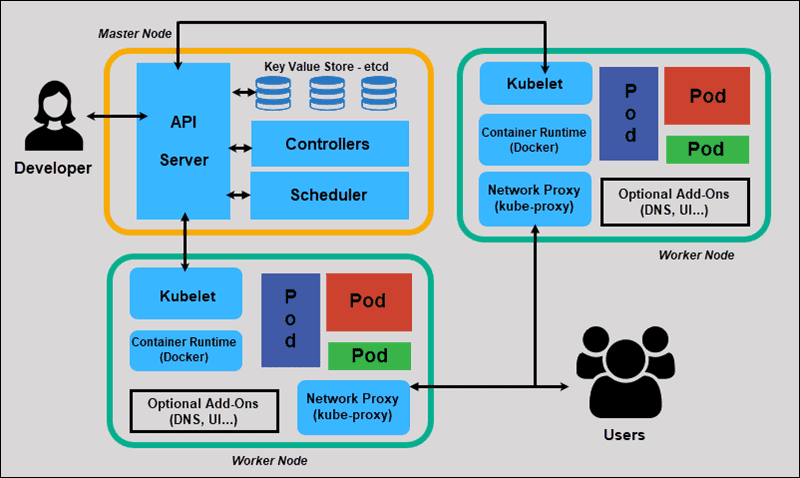
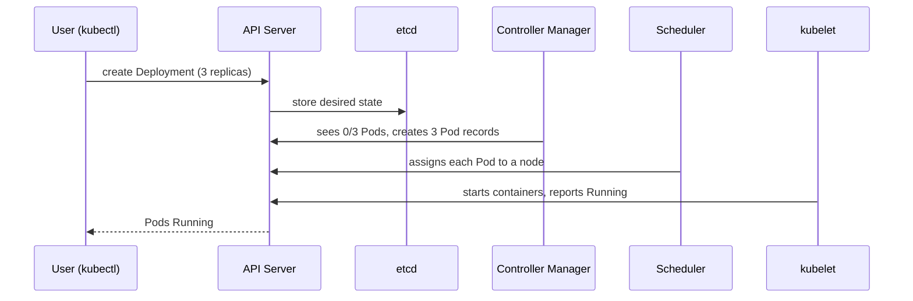

# 1. Kubernetes Fundamentals

*Background theory for the experiment. Navigation: [README](../README.md) · **Fundamentals** · [Jobs & CronJobs](02-jobs-and-cronjobs-theory.md) · [Procedure](03-procedure.md) · [Results](04-observations-and-results.md) · [Viva](05-viva-questions.md)*

---

## 1.1 What is Kubernetes?

**Kubernetes** (abbreviated **K8s**) is an open-source **container orchestration platform**. Orchestration means automatically managing a large number of containers: starting them, restarting them when they fail, placing them on suitable machines and scaling them up or down.

> **In one sentence:** Kubernetes automatically runs, heals and scales containers across a group of machines.

### Without and with Kubernetes

| Without Kubernetes | With Kubernetes |
|---|---|
| Every container is started by hand | The user declares the **desired state**, e.g. "run 3 copies" |
| A crashed container must be noticed and restarted manually | Crashed containers are replaced automatically |
| The administrator decides which machine runs what | The scheduler selects a suitable machine for every Pod |
| Scaling means adding copies manually | Scaling up or down needs one command |

*Analogy:* ordering "3 pizzas" is the desired state. The kitchen keeps checking, and if one pizza is dropped it prepares another without being asked.

## 1.2 Why use a cluster instead of one machine?

A **cluster** is a group of machines managed as a single system.

| Single machine | Cluster |
|---|---|
| If it fails, every container stops | Keeps running if one node fails |
| Limited CPU and memory | More room to grow by spreading copies over several machines |
| Manual recovery | **Self-healing:** work is restarted or moved automatically |
| Address changes when the container moves | **One stable address** through a Service |

A cluster also makes it possible to study automation, scaling, fault recovery, scheduling, resource use and load balancing.

## 1.3 Cluster architecture

*Figure 1.1: Kubernetes architecture (control plane and worker nodes).*

A cluster has two kinds of machines:

* **Control plane (the "brain")** stores the state of the cluster and decides what should happen next.
* **Worker nodes (the "muscles")** are the machines where applications, packaged inside Pods, actually run.

The two sides communicate continuously. This constant *check-and-fix loop* is what makes Kubernetes automatic.

### Components

| Component | Location | Function | Analogy |
|---|---|---|---|
| **API Server** | Control plane | Front door of the cluster; every request from the user or from other components passes through it | Order desk |
| **etcd** | Control plane | Key-value database holding the desired and actual state of the cluster | Order book |
| **Scheduler** | Control plane | Selects a worker node for every new Pod that has none | Head chef |
| **Controller Manager** | Control plane | Continuously compares desired state with actual state and corrects any gap (the **Job controller** used in this lab is part of it) | Floor supervisor |
| **kubelet** | Every worker node | Agent that starts the node's Pods and reports their status | Cook at each station |
| **kube-proxy** | Every worker node | Sets up networking so traffic sent to a Service reaches the right Pods | Waiter routing orders |
| **Container runtime** | Every worker node | Software that starts and stops containers (e.g. containerd) | The stove |

**Golden rule:** all components communicate through the API Server, and only the API Server talks to etcd.

## 1.4 What happens when a command is run?

Example: `kubectl create deployment web --image=nginx --replicas=3`

| Step | Component | Action |
|---|---|---|
| 1 | You → API Server | `kubectl` sends the request. Nothing is started yet. |
| 2 | API Server → etcd | The desired state "web should have 3 copies" is saved. |
| 3 | Controller Manager | Notices 0 of 3 Pods exist and creates 3 Pod records. |
| 4 | Scheduler | Finds Pods without a node and assigns each to a worker node. |
| 5 | kubelet | On the chosen node, asks the container runtime to start the container. |
| 6 | Status → You | kubelet reports back through the API Server; the Pod shows `Running`. |

## 1.5 Nodes, Pods and containers

| Object | Description |
|---|---|
| **Node** | A physical or virtual machine providing CPU, memory, network and storage |
| **Pod** | The smallest deployable unit; usually wraps one container (it may hold several tightly coupled ones) |
| **Container** | The application packaged with everything it needs to run |

*Analogy:* Node = kitchen station, Pod = plate, Container = food on the plate.

Pods are **replaceable**. If a Pod dies, a new one is created, possibly on another node and with a new IP address.

## 1.6 Core API objects

| Object | Purpose | Example |
|---|---|---|
| **Deployment** | Keeps *N* replicas of a long-running application running and replaces failed ones | `replicas: 3` |
| **Service** | Gives a group of Pods one stable name/IP and spreads traffic across them (simple load balancing) | `web-svc` → Pods with `app=web` |
| **Labels & selectors** | Labels are name-tags on objects; selectors find objects by their tags | `app=web` |
| **Namespace** | Separate areas inside one cluster to organise teams or projects | `dev`, `test`, `prod` |
| **Job** | Runs a Pod until it **completes successfully**, then stops *(this experiment)* | one-time report |
| **CronJob** | Creates Jobs **on a schedule** *(this experiment)* | nightly backup |

> Deployments suit workloads that must run *continuously*. Jobs and CronJobs suit workloads that must run *to completion*. See [Chapter 2](02-jobs-and-cronjobs-theory.md).

## 1.7 Scheduling, CPU and memory

The **Scheduler** places a new Pod in three steps:

1. **Filter:** remove nodes that cannot meet the Pod's requests or rules.
2. **Score:** rank the remaining nodes and pick the best one.
3. **Bind:** save the decision through the API Server; that node's kubelet starts the Pod.

**Requests and limits**

* **Request** is the amount of CPU/memory the Pod needs; the Scheduler reserves it when choosing a node.
* **Limit** is the maximum it may use. Above the CPU limit the container is throttled; above the memory limit it is stopped and restarted.

Units: `1` CPU = 1 core, `500m` = 0.5 core; `Mi`/`Gi` ≈ MB/GB.

*Worked example:* a node has 4 CPU cores and Pods A, B, C have reserved 1 + 0.5 + 1 = 2.5 cores. Only 1.5 cores are unreserved, so a new Pod requesting 2 CPU cannot be placed on this node.

## 1.8 Practice clusters

| Tool | Description |
|---|---|
| **minikube** | Local single-node cluster; the simplest choice for first steps. **Used in this lab.** |
| **kind** | "Kubernetes IN Docker"; every node is a Docker container, convenient for multi-node clusters. A sample configuration is provided in [`setup/kind-config.yaml`](../setup/kind-config.yaml). |

Both run on a personal computer and need no cloud account. They are learning environments, not production clusters.

## 1.9 Frequently used `kubectl` commands

| Command | Shows | What to look for |
|---|---|---|
| `kubectl get nodes` | Every machine in the cluster | `STATUS` = `Ready` |
| `kubectl get pods -o wide` | Each Pod and the node it runs on | `NODE` column |
| `kubectl get deployments` | Applications and ready copies | `READY` e.g. `3/3` |
| `kubectl get services` | Stable addresses of applications | `CLUSTER-IP`, `PORT(S)` |
| `kubectl describe <kind> <name>` | Detailed state and recent **events** | `Events:` section |
| `kubectl logs <pod>` or `job/<name>` | Standard output of a container | application output |
| `kubectl apply -f <file>` | Creates/updates objects from a YAML file | confirmation message |
| `kubectl delete -f <file>` | Deletes the objects defined in a file | confirmation message |
| `kubectl scale deployment web --replicas=5` | Changes the number of copies | new Pods appearing |

## 1.10 Glossary

| Term | Meaning |
|---|---|
| Cluster | Group of machines run as one system |
| Control plane | Stores state and makes decisions |
| API Server | Front door for every request |
| etcd | Database holding cluster state |
| Scheduler | Picks a node for each new Pod |
| Controller Manager | Compares asked-for vs. running state and fixes gaps |
| Worker node | Machine where Pods run |
| kubelet | Agent that runs Pods on its node |
| Pod | Smallest unit; wraps one or more containers |
| Deployment | Keeps *N* copies of an application running |
| Service | Stable address that spreads traffic over Pods |
| Request / Limit | CPU/memory reserved / maximum allowed |
| Job | Run-to-completion workload |
| CronJob | Scheduled creator of Jobs |

---
*Content in this chapter is adapted from the course deck "Kubernetes: From Containers to a Working Cluster".*
