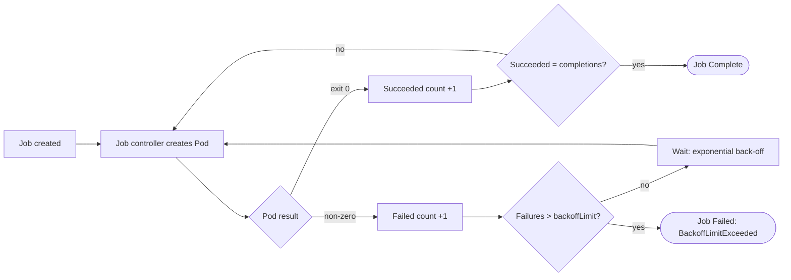
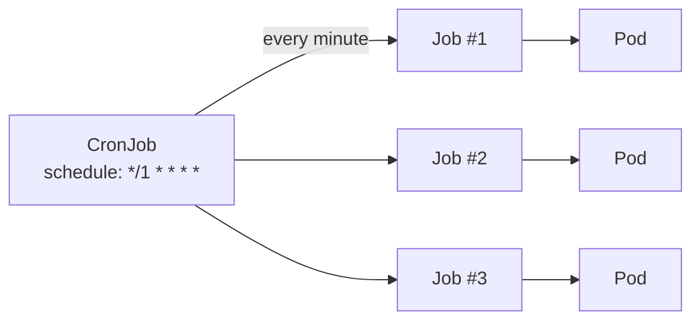

# 2. Theory: Jobs and CronJobs

*Navigation: [README](../README.md) · [Fundamentals](01-kubernetes-fundamentals.md) · **Jobs & CronJobs** · [Procedure](03-procedure.md) · [Results](04-observations-and-results.md) · [Viva](05-viva-questions.md)*

---

## 2.1 Long-running versus batch workloads

Not every workload is a service that runs forever.

| Workload type | Behaviour | Kubernetes object | Examples |
|---|---|---|---|
| **Long-running service** | Should always be up; if it exits it is restarted | Deployment | web server, API |
| **Batch (run-to-completion)** | Runs, finishes successfully and stops | **Job** | report generation, data migration |
| **Scheduled batch** | Runs repeatedly at fixed times | **CronJob** | nightly backup, hourly clean-up |

> *Analogy:* a website is a shop that stays open all day. A batch task is a worker who does one job ("print today's sales report") and then goes home.

## 2.2 Job

A **Job** creates one or more Pods and ensures that a specified number of them **terminate successfully**. When the required number of successful completions is reached, the Job is complete and no further Pods are created.

### Important fields

| Field | Meaning | Value used in this lab |
|---|---|---|
| `spec.completions` | Number of successful Pod runs required | `3` |
| `spec.parallelism` | Number of Pods allowed to run at the same time | `1` |
| `spec.backoffLimit` | Number of **retries** before the Job is marked `Failed` | `4` (success Job), `3` (failing Job) |
| `spec.template.spec.restartPolicy` | What happens to the container on failure; for Jobs only `Never` or `OnFailure` are allowed (never `Always`) | `Never` |

### Job lifecycle



### Retry behaviour and exponential back-off

When a Pod fails, the Job controller creates a **new Pod** to retry. The delay before each retry **increases** (approximately 10 s, 20 s, 40 s, … capped at 6 minutes). This is called *exponential back-off* and prevents a broken task from overloading the cluster.

With `backoffLimit: 3`, a permanently failing Job produces **4 Pods**: the first attempt plus 3 retries. Afterwards the Job is marked **Failed** with the reason `BackoffLimitExceeded`.

## 2.3 CronJob

A **CronJob** creates Jobs automatically on a repeating schedule written in standard **cron syntax**:

```
┌───────────── minute (0-59)
│ ┌─────────── hour (0-23)
│ │ ┌───────── day of month (1-31)
│ │ │ ┌─────── month (1-12)
│ │ │ │ ┌───── day of week (0-6, Sunday = 0)
│ │ │ │ │
* * * * *
```

| Schedule | Meaning |
|---|---|
| `*/1 * * * *` | every minute *(used in this lab)* |
| `0 9 * * *` | every day at 09:00 |
| `0 2 * * 0` | every Sunday at 02:00 |



### Important fields

| Field | Meaning | Value used |
|---|---|---|
| `spec.schedule` | When to create a Job | `"*/1 * * * *"` |
| `spec.successfulJobsHistoryLimit` | How many successful Jobs are kept as run history | `3` |
| `spec.failedJobsHistoryLimit` | How many failed Jobs are kept | `1` |
| `spec.jobTemplate` | Template of the Job created at each run | runs `batch-app:1.0` |

Older Jobs beyond the history limit are deleted automatically together with their Pods.

> The Job names created by a CronJob contain the scheduled time as a number of minutes since the Unix epoch (e.g. `report-cronjob-29907642`). Consecutive runs therefore differ by `1`.

## 2.4 Why this matters

* Real systems need **tasks that must finish** (reports, migrations, data processing) and **tasks that must repeat** (backups, clean-up, e-mail digests).
* Kubernetes provides the same guarantees for them as for services: **automatic retry, tracking of completion, logs per Pod, no manual supervision**.

## 2.5 Summary

| Concept | One-line summary |
|---|---|
| Job | Run a task to successful completion, retrying on failure |
| `completions` | How many successful runs are needed |
| `backoffLimit` | How many retries are allowed |
| `restartPolicy` | `Never` or `OnFailure` for Jobs |
| CronJob | A Job factory driven by a cron schedule |
| History limits | How many past Jobs are retained |
