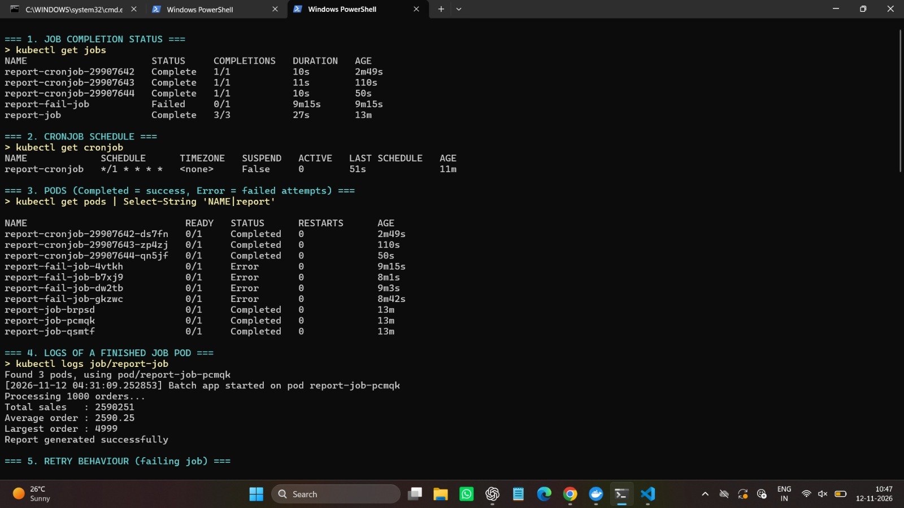
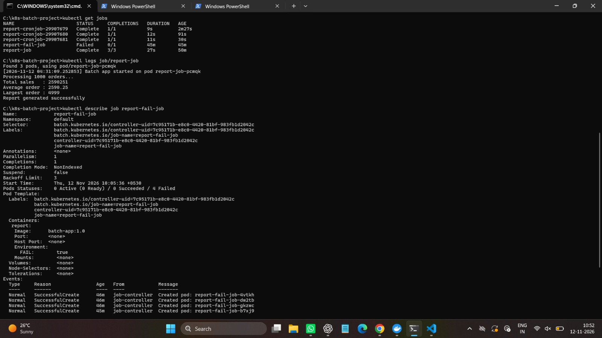
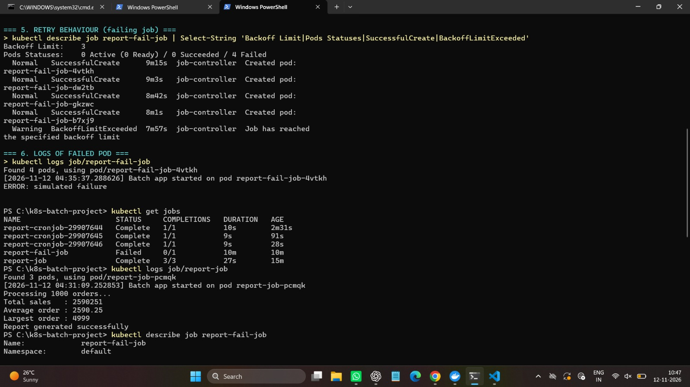
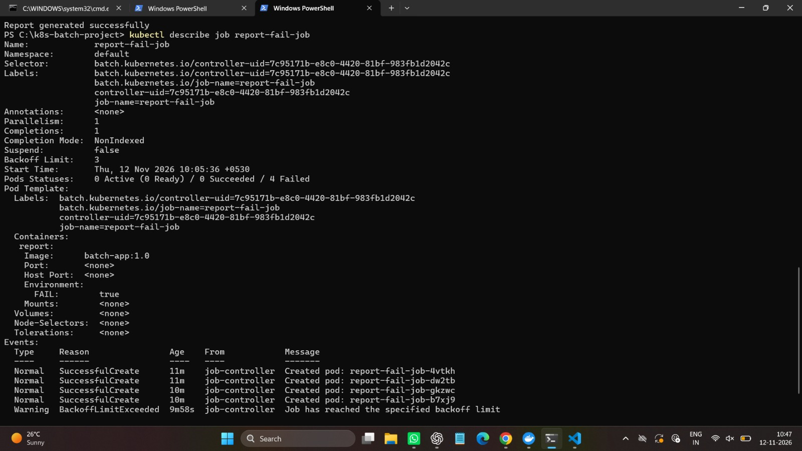

# 4. Observations and Results

*Navigation: [README](../README.md) · [Fundamentals](01-kubernetes-fundamentals.md) · [Jobs & CronJobs](02-jobs-and-cronjobs-theory.md) · [Procedure](03-procedure.md) · **Results** · [Viva](05-viva-questions.md)*

All outputs below were captured from the actual execution of this experiment on **12 November 2026** (Kubernetes v1.35.1 on minikube, Docker driver, Windows).

---

## 4.1 Experiment 1: Job completion status



*Figure 4.1: `kubectl get jobs`, `kubectl get cronjob`, `kubectl get pods` and Job logs.*

```
NAME         STATUS     COMPLETIONS   DURATION   AGE
report-job   Complete   3/3           27s        13m
```

Log of one of the three Pods:

```
Batch app started on pod report-job-pcmqk
Processing 1000 orders...
Total sales   : 2590251
Average order : 2590.25
Largest order : 4999
Report generated successfully
```

| Observation | Result |
|---|---|
| Required completions | 3 |
| Successful completions | **3 / 3** |
| Total duration | 27 s (Pods ran one after another, about 9 s each) |
| Pod status | `Completed` for all three Pods |
| Output | Sales report generated successfully |

**Inference:** the Job controller created Pods one at a time (`parallelism: 1`) until three had succeeded and then stopped creating new Pods.

---

## 4.2 Experiment 2: CronJob run history

From Figure 4.1:

```
NAME             SCHEDULE      SUSPEND   ACTIVE   LAST SCHEDULE   AGE
report-cronjob   */1 * * * *   False     0        51s             11m

NAME                      STATUS     COMPLETIONS   DURATION   AGE
report-cronjob-29907642   Complete   1/1           10s        2m49s
report-cronjob-29907643   Complete   1/1           11s        110s
report-cronjob-29907644   Complete   1/1           10s        50s
```

| Observation | Result |
|---|---|
| Schedule | `*/1 * * * *` (every minute) |
| Job names | numbers differ by exactly 1 (`…642`, `…643`, `…644`), i.e. one Job per minute |
| Duration of each run | about 10 s |
| Active Jobs between runs | 0 |

**History limit.** A later capture (Figure 4.2, about 50 minutes after the start) shows only the **latest three** CronJob runs (`…679`, `…680`, `…681`); the earlier ones were removed automatically, as defined by `successfulJobsHistoryLimit: 3`. The one-time Jobs are not touched by this limit.



*Figure 4.2: Run history about 50 minutes after the start; the CronJob keeps only the last three successful Jobs.*

---

## 4.3 Experiment 3: Failing Job and retry behaviour



*Figure 4.3: Retry attempts, the `BackoffLimitExceeded` event and the log of a failed Pod.*



*Figure 4.4: `kubectl describe job report-fail-job`.*

Key lines:

```
Backoff Limit:  3
Pods Statuses:  0 Active (0 Ready) / 0 Succeeded / 4 Failed

Events:
  Normal   SuccessfulCreate      Created pod: report-fail-job-4vtkh
  Normal   SuccessfulCreate      Created pod: report-fail-job-dw2tb
  Normal   SuccessfulCreate      Created pod: report-fail-job-gkzwc
  Normal   SuccessfulCreate      Created pod: report-fail-job-b7xj9
  Warning  BackoffLimitExceeded  Job has reached the specified backoff limit
```

Log of the failed Pod:

```
Batch app started on pod report-fail-job-4vtkh
ERROR: simulated failure
```

### Timing of the retries

Event ages from Figure 4.3 (measured backwards from the time of the capture):

| Attempt | Pod | Event age | Delay since previous Pod |
|---|---|---|---|
| 1 (initial) | `report-fail-job-4vtkh` | 9 m 15 s | n/a |
| 2 (retry 1) | `report-fail-job-dw2tb` | 9 m 3 s | **12 s** |
| 3 (retry 2) | `report-fail-job-gkzwc` | 8 m 42 s | **21 s** |
| 4 (retry 3) | `report-fail-job-b7xj9` | 8 m 1 s | **41 s** |
| (stop) | `BackoffLimitExceeded` | 7 m 57 s | 4 s after the last Pod failed |

The delay roughly **doubles** after every failure, which is the exponential back-off described in [Section 2.2](02-jobs-and-cronjobs-theory.md#22-job).

| Observation | Result |
|---|---|
| `backoffLimit` | 3 |
| Pods created | **4** (1 initial + 3 retries) |
| Succeeded | 0 |
| Final Job status | `Failed`, reason `BackoffLimitExceeded` |
| Cause (from log) | `ERROR: simulated failure` (`exit 1`) |

---

## 4.4 Summary of results

| Item to demonstrate | Evidence | Outcome |
|---|---|---|
| Job completion status | `report-job   Complete   3/3` | Achieved |
| Retry attempts | 4 failed Pods, growing delays 12 s → 21 s → 41 s | Achieved |
| Retry limit enforced | `BackoffLimitExceeded`, Job `Failed` | Achieved |
| CronJob run history | One Job per minute; only the last 3 retained | Achieved |
| Logs of finished Pods | Sales report (success) and `ERROR: simulated failure` (failure) | Achieved |

## 4.5 Discussion

1. A **Job** guarantees completion: it continued creating Pods until three succeeded, so the user does not have to supervise the task.
2. Failure is handled **automatically** by creating a new Pod, but not indefinitely. `backoffLimit` bounds the retries, and increasing delays protect the cluster from a tight failure loop.
3. A **CronJob** removes the need for an external scheduler: it creates one Job per schedule tick and cleans up old runs according to the history limits.
4. Each run is isolated in its own Pod, so its logs and status can be inspected separately with `kubectl logs` and `kubectl describe`.
5. The total number of Pods for the Job in 4.1 is three. Pod names (e.g. `report-job-pcmqk`) are random suffixes generated by Kubernetes.

## 4.6 Conclusion

The experiment demonstrated that Kubernetes Jobs run tasks to successful completion and track them, that failing tasks are retried with exponential back-off until the configured limit is reached, and that CronJobs launch Jobs automatically on a cron schedule while retaining a limited run history. Thus, Kubernetes can manage not only long-running services but also run-to-completion and scheduled batch workloads.
